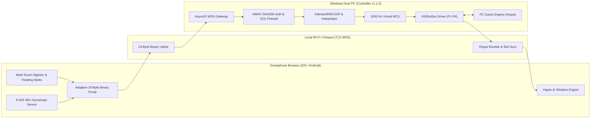
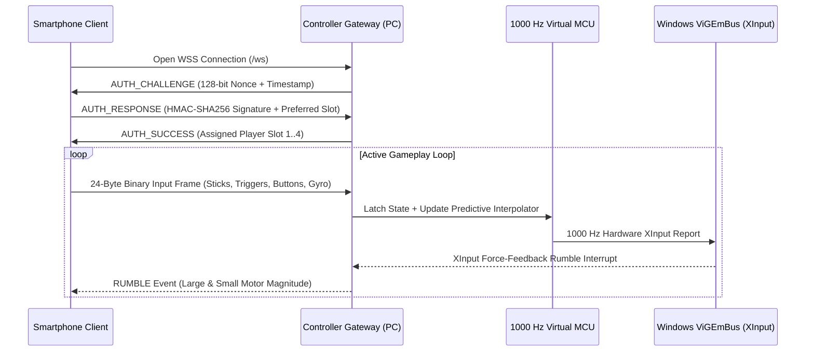

<div align="center">

# Controller

**Turn any smartphone into a sub-5ms wireless Xbox 360 controller for Windows PC.**  
*No app store downloads. No cables. No subscriptions. Just scan and play.*

[](https://github.com/unitynimit/controller/stargazers)
[](https://github.com/unitynimit/controller/releases)
[](#benchmarks)
[](https://github.com/unitynimit/controller)
[](LICENSE)

[**Quick Start**](#-quick-start-60-seconds) • [**Features**](#-why-controller) • [**Controls**](#-mobile-controls--gestures) • [**Architecture & Benchmarks**](#-under-the-hood) • [**Run from Source**](#-run-from-source--cli)

<br>

<!-- 🔄 REPLACE THE IMAGE LINK BELOW WITH YOUR ACTUAL CONTROLLER SCREENSHOT OR PHOTO -->


</div>

---

## The Idea

Ever wanted to jump into a racing sim, platformer, or 4-player couch co-op game with friends, only to realize you are short on gamepads? Every smartphone already carries a high-refresh multi-touch digitizer, a 6-axis gyroscope, and a haptic motor in your pocket.

**Controller** bridges your phone's browser directly to the Windows kernel (`ViGEmBus`). Launch the server on your PC, scan the QR code with your phone camera, and Windows immediately recognizes your phone as a native **Xbox 360 (`XInput`) controller**—compatible out of the box with Steam, Epic Games, Xbox Game Pass, and standalone titles.

---

## Why Controller?

- **Zero Mobile Install**: Runs directly inside Safari (iOS) or Chrome (Android) over local Wi-Fi or Windows Mobile Hotspot.
- **Native Xbox 360 Emulation**: Emulates up to **4 simultaneous `XInput` controllers** (`P1`–`P4`) at the kernel level via ViGEmBus. Swap player slots live from your phone or PC.
- **Sub-5ms Binary Engine**: Ditches bloated JSON for a custom **24-byte zero-copy binary wire protocol (`BINARY v2`)** paired with a **1000 Hz Virtual MCU** hardware dispatch thread.
- **6-DoF Gyro Steering**: Tilt to steer in racing games with discrete Kalman + EMA signal filtering, adjustable deadbands, and a live horizon indicator.
- **Bi-Directional Rumble**: Relays native dual-motor `XInput` force-feedback interrupts from PC games straight back to your phone's haptics.
- **Instant Layout Customization**: Hold the center logo for `450ms` to drag, resize, and tune thumbstick radii directly on your screen.
- **Two Editions Included**:
  - **`Controller.exe` (GUI Edition)**: Monochromatic 60 FPS telemetry dashboard with QR pairing, 1-click driver setup, and per-player oscilloscopes.
  - **`Controller-Terminal.exe` (Terminal Edition)**: Zero-GUI console server built for minimum system overhead and competitive play.

---

## Quick Start (60 Seconds)

1. **Launch the Server**: Run `dist\Controller.exe` (GUI) or `dist\Controller-Terminal.exe` (Headless).
2. **Install the Driver *(One-Time)***: Click **INSTALL DRIVER** in the top bar (or run `scripts\install_driver.bat` as Administrator) to install the ViGEmBus virtual Xbox driver. No reboot needed.
3. **Scan & Connect**: Make sure your phone and PC are on the same Wi-Fi *(Pro tip: use **Windows Mobile Hotspot** for the lowest possible ping)*. Scan the QR code or visit `https://<YOUR_PC_IP>:8443`.
   > *Note: On first visit, tap **Advanced → Proceed** past the local self-signed SSL prompt.*
4. **Play**: Tap the center logo on your phone to lock into fullscreen landscape mode and jump into your game.

---

## Mobile Controls & Gestures

Everything on the mobile web interface is controlled through the **Center Logo** and **Gyro Circle**—keeping the screen clutter-free during gameplay:

| Gesture | Action |
| :--- | :--- |
| **Tap Center Logo** *(Splash Screen)* | Enter fullscreen landscape gamepad mode |
| **Quick Tap Center Logo** *(In-Game)* | Open / close the **Settings Overlay** (Swap `P1`–`P4`, toggle Vibration, Reset layout) |
| **Hold Center Logo (`450ms`)** | Enter / exit **Layout Customization Mode** (Drag buttons, resize controls, adjust stick radii) |
| **Tap Center Gyro Circle** | Toggle **6-DoF Gyroscope Motion Steering** ON / OFF |

---

## Under the Hood

Wireless browser controllers usually suffer from Wi-Fi bufferbloat, packet bursts, and Python GIL stutter. **Controller v1.1.0** solves all four:

1. **24-Byte `BINARY v2` Protocol**: Packs sequence numbers, timestamps, four 16-bit stick axes (`LX, LY, RX, RY`), two 8-bit triggers (`LT, RT`), a 16-bit button bitmask, 16-bit gyro angle, flags, and RTT telemetry into 24 bytes—cutting payload size by **>88%** vs. JSON.
2. **Anti-Bufferbloat Adaptive Pacing**: Streams at up to **400 Hz (`2.5ms`)** during active movement and throttles down to **40 Hz (`25ms`)** when idle. Gated at `bufferedAmount <= 256` bytes so stale frames never queue in the phone's Wi-Fi chip.
3. **Wi-Fi A-MPDU Burst Coalescing**: Coalesces back-to-back burst frames when button states match, while strictly preserving every button press/release edge in exact sequence.
4. **1000 Hz Virtual MCU Thread**: Locks Windows kernel timer resolution to `0.5ms` (`NtSetTimerResolution`) with predictive dead-reckoning interpolation to feed `ViGEmBus` at a rock-solid 1000 Hz.

### Benchmarks
*Tested under multi-client TLS + 1000 Hz MCU + 60 FPS GUI + simulated Wi-Fi bursts:*

| Metric | v1.1.0 Result | Metric | v1.1.0 Result |
| :--- | :---: | :--- | :---: |
| **Median (P50) RTT** | `4.37 ms` | **Max Spike (Wi-Fi Burst)** | `11.70 ms` |
| **Mean RTT** | `4.52 ms` | **Spikes > 30 ms** | `0` |
| **P95 / P99 RTT** | `6.41 ms` / `10.03 ms` | **Unexpected Drops** | `0` |

<details>
<summary><b>View System Architecture & Streaming Pipeline Diagrams</b></summary>
<br>

### System Architecture


### Low-Latency Streaming Pipeline

</details>

---

## Run from Source & CLI

Requires **Python 3.10+** on Windows 10/11:

```powershell
# Install dependencies
pip install -r requirements.txt

# Launch Desktop GUI Edition
python main.py

# Or launch Zero-GUI Terminal Edition
python terminal_main.py
```

<details>
<summary><b>CLI Flags, Terminal Shortcuts & Build Commands</b></summary>
<br>

### Command-Line Flags
| Flag | Description |
| :--- | :--- |
| `-v`, `--version` | Display version (`Controller v1.1.0`) and exit |
| `-h`, `--help` | Display command-line help and interactive shortcuts |
| `--headless`, `--no-gui` | Run `Controller.exe` in headless terminal mode |
| `--port <int>` | Specify a custom WebSocket/HTTPS port (default: `8443`) |
| `--no-ssl` | Run over plain HTTP/WS instead of HTTPS/WSS |

### Interactive Terminal Shortcuts (`Controller-Terminal.exe`)
| Key / Command | Action |
| :--- | :--- |
| `s` / `swap` | Swap Player 1 and Player 2 controller slots |
| `t` / `test [sec]` | Trigger a test vibration pulse on Player 1 |
| `stop` | Immediately stop active vibration on Player 1 |
| `p` / `pulse` | Pulse Button A on Player 1 to wake up browser gamepad testers |
| `status` | Display connected phones and player slot assignments |
| `q` / `quit` | Gracefully shut down the server |

### Test & Build Standalone Executables
```powershell
# Run the 80-test automated unit, stress, and security suite
python -m pytest tests/ -v

# Build Controller.exe and Controller-Terminal.exe via PyInstaller
pyinstaller --clean -y Controller.spec
```
</details>

<details>
<summary><b>Repository Structure</b></summary>
<br>

| Path | Description |
| :--- | :--- |
| `main.py` / `terminal_main.py` | Entrypoints for GUI (`Controller.exe`) and Terminal (`Controller-Terminal.exe`) editions |
| `config/settings.py` | Version (`1.1.0`), ports, DSP filter constants, and security parameters |
| `gateway/server.py` | AsyncIO HTTPS/WSS server, burst coalescer, slot router, and static asset handler |
| `gateway/input_manager.py` | 4-player ViGEmBus Xbox 360 manager and `SendInput` keyboard fallback |
| `gateway/mcu_dispatch.py` | 1000 Hz Virtual MCU hardware dispatch engine with micro-interpolation |
| `gateway/predictive_interpolator.py` | Per-axis dead-reckoning and smooth micro-interpolation engine |
| `gateway/kernel_transport.py` | `TCP_NODELAY` socket tuner and 24-byte `BINARY v2` struct decoder |
| `gateway/filters.py` | Discrete 2-state Kalman filter, EMA low-pass filter, deadband, and steering curves |
| `gateway/security.py` | HMAC-SHA256 challenge-response authenticator and `O(1)` deque anomaly firewall |
| `gui/dashboard.py` & `state_bridge.py` | Monochromatic 60 FPS CustomTkinter telemetry dashboard and thread-safe state bridge |
| `client/` | Zero-dependency mobile web gamepad (`cockpit.js`, `digitizer.js`, `gyro.js`, `haptics.js`, `layout_customizer.js`) |
| `tests/` | 80 automated unit, stress, security, and end-to-end integration tests |
</details>

---

## Star History

If **Controller** saved you from buying an extra gamepad (or made couch co-op night happen), consider dropping a ⭐ on the repo!

<div align="center">

## Star History

<a href="https://www.star-history.com/?repos=%253CYOUR_USERNAME%253E%2F%253CYOUR_REPO%253E%2Ccontroller%2Fcontroller%2Cunitynimit%2Fcontroller&type=date&legend=top-left">
 <picture>
   <source media="(prefers-color-scheme: dark)" srcset="https://api.star-history.com/chart?repos=%3CYOUR_USERNAME%3E/%3CYOUR_REPO%3E%2Ccontroller/controller%2Cunitynimit/controller&type=date&theme=dark&legend=top-left" />
   <source media="(prefers-color-scheme: light)" srcset="https://api.star-history.com/chart?repos=%3CYOUR_USERNAME%3E/%3CYOUR_REPO%3E%2Ccontroller/controller%2Cunitynimit/controller&type=date&legend=top-left" />
   
 </picture>
</a>
</div>

---

## License

Released under the [**MIT License**](LICENSE). 100% free and open source—forever.
